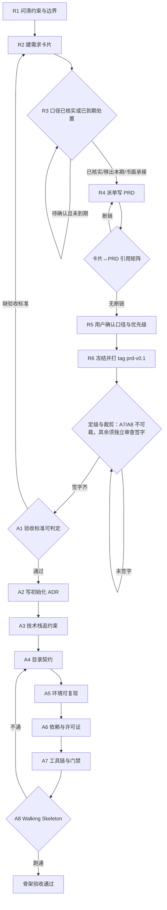

# 新项目：从需求到骨架跑通（W-001）

> 归属总纲：[AGENTS.md](../AGENTS.md)｜本工作流串起 [S-003](../skills/S-003-requirements-intake.md) → [S-002](../skills/S-002-project-bootstrap.md)，细则见 [rules/14](../rules/14-project-bootstrap.md)

- **目标**：把"只有口头想法"稳定推进到"一条命令跑通最薄端到端路径"，中途每个卡点都有明确回退位置。
- **包含的 skill**：S-003（R1~R6 需求收集与冻结）→ S-002（A1~A8 项目创建与骨架验收）。

## 流程图

## 每步的输入 / 输出

| 步骤 | 输入 | 输出 |
| --- | --- | --- |
| R1 | 用户的初步描述 | 五栏边界：谁用／解决什么／数据来源／合规红线／明确不做 |
| R2 | 五栏边界 | 需求卡片（`RQ-001` 起），每项带出处与状态（用户已确认／待确认／Agent 假设） |
| R3 | 卡片中的财税条目 | 政策名称＋条款＋核实状态；待确认项带到期日，超期给出"移出本期/书面承接"结论 |
| R4 | 已核实口径的卡片 | PRD 草稿（子 Agent 写）＋"卡片↔PRD 条款"引用矩阵 |
| R5 | 引用矩阵＋PRD | 用户对业务口径与优先级的明确确认 |
| R6 | 已确认的 PRD | 冻结基线：tag `prd-v0.1`；口头新增已补变更单 |
| G | 项目级别＋拟裁步骤清单 | 定级结论＋独立审查者签字；A7/A8 未出现在裁剪清单 |
| A1 | 冻结的 PRD | 逐卡可执行判定结论；不可判定清单 |
| A2 | 约束清单 | 初始化 ADR：约束／选型／否决项／可推翻条件 |
| A3 | ADR 选型 | 每个选型对应的约束原文与出处 |
| A4 | 选型结论 | 目录骨架＋每目录一句职责 |
| A5 | 骨架 | 版本锁定、`.env.example`、README"5 分钟上手" |
| A6 | 依赖清单 | 最小依赖表＋许可证结论（无 GPL/AGPL 类） |
| A7 | 代码骨架 | 一条命令跑完全部门禁，失败可复现 |
| A8 | 全部前置产物 | 端到端跑通输出与日志，交付验收 |

## 卡点与回退位置

| 卡在哪 | 判定依据 | 退回哪一步 |
| --- | --- | --- |
| 五栏边界有空白 | 卡片字段空缺 | 停在 R1，向用户补问（只问业务） |
| 政策依据"待确认"且未到期 | 到期日字段 | 停在 R3 等补证；到期仍不实则移出本期或由用户书面承接 |
| 裁剪无独立审查签字 | ADR 签字栏为空，或裁到 A7/A8 | 退回 G，补齐签字或恢复该步 |
| 裁 A5 但未改 A7 口径 | ADR 无 A7 等效判据 | 退回 G，改写 A7 判定口径后才可裁 |
| 必答项无出处 | 出处栏空白 | 退回 R2，标为 Agent 假设或向用户补问 |
| 引用矩阵断链 | 某 RQ 无对应条款，或某条款无来源 | 退回 R4，由原子 Agent 重写 |
| 用户不确认口径 | 回复未明确"口径与优先级确认" | 退回 R4，技术项从确认清单剔除后重报 |
| 验收标准不可判定 | 出现"良好""正常"或无可执行操作 | 退回 R2 重写卡片 |
| 选型追不到约束 | 无约束原文与出处 | 退回 A2 重写 ADR |
| 骨架跑不通 | A8 命令非零退出 | 退回 A4（结构调整）或 A3（选型错误） |
| 口头指令未补登记 | 无变更单 | 退回 R6，补登记后才算发生 |
| 门禁只在本人机器可用 | 干净环境无法一条命令跑通 | 退回 A5，补 lock 与上手文档 |

## 沉淀说明

- 由 2026-11-18 用户批准新增"项目创建与需求收集"规则时反哺：S-003 承载需求侧，S-002 承载创建侧，本工作流固定两者的交接点（冻结 PRD 与 tag）。
- **版本**：v1.0
